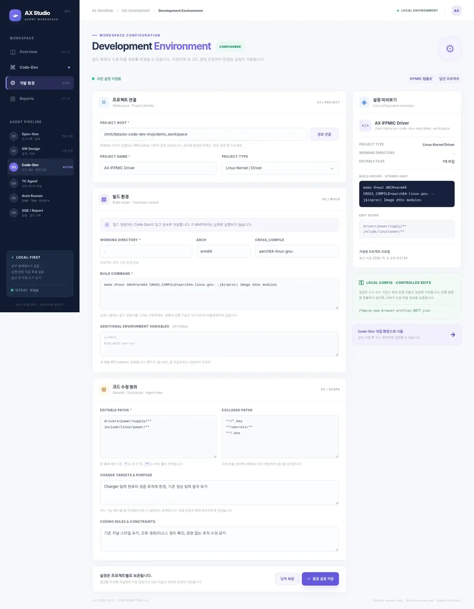

# AX Code-Dev Studio — 로컬 GUI MVP v0.2

AX의 Code-Dev 단계에 사용하는 로컬 웹 GUI입니다. **처음에는 개발 환경을 설정**하고, 이후에는 언제든 수정할 수 있습니다. 코드 생성·수정 제안 → Diff 검토 → 사용자 승인에 따른 한 파일 반영까지만 자동화합니다. 실제 **빌드/테스트/플래싱/셸 명령은 실행하지 않습니다.**



## 1. 구성과 실행

- Python **3.9 이상** (표준 라이브러리만 필요), 웹 브라우저
- 선택: 실제 LLM 제안용 로컬 Ollama (`ollama serve`)
- 권장: **WSL Ubuntu에서 Python 서버+Ollama 실행 / Windows Edge·Chrome에서 GUI 접속**

```bash
git clone https://github.com/Dong-Ha/CODEdev.git
cd CODEdev
python3 app.py
```

브라우저 주소: `http://127.0.0.1:8765`

```bash
# 포트 변경
AX_PORT=8766 python3 app.py

# 로컬 Ollama가 다른 포트에 있을 때
AX_OLLAMA_HOST=http://127.0.0.1:11435 python3 app.py
```

서버는 `127.0.0.1`에만 바인딩하며 외부 서버에 공개하지 않습니다. 첫 실행 시 별도의 `pip install`은 필요하지 않습니다. 일부 WSL 환경은 Windows localhost 포워딩을 확인해야 합니다.

## 2. 최초 환경 설정 → 반복 개발

1. 첫 시작 시 **Development Environment** 페이지가 자동 표시됩니다. 예제 `demo_workspace`를 쓰거나 Linux 프로젝트의 절대 경로를 입력하고 **경로 연결**을 누르세요. 경로는 **Python 서버가 실행되는 WSL/Linux 기준**입니다.
2. **프로젝트**: 이름, 유형(Linux Kernel / 일반 소스)을 입력합니다.
3. **빌드 환경**: 프로젝트 루트 내 작업 폴더(상대 경로), `ARCH`, `CROSS_COMPILE`, 실제 사용하는 **빌드 명령어**, 선택적인 `KEY=value` 형식 추가 환경변수를 입력합니다. 실제 명령어가 아닌 예시 템플릿으로 시작할 수도 있지만, 실환경에서는 명령어를 교체하세요.
4. **수정 범위**: 한 줄에 하나씩 허용 경로와 제외 경로 패턴을 입력합니다. 변경 대상 함수·기능과 코딩 규칙도 기록하세요.
5. **환경 설정 저장**을 클릭합니다. 저장된 프로필에 따라 수정 가능한 파일 목록이 갱신되고 Code-Dev 화면이 열립니다.
6. 작업 요청을 입력하고 **Demo / Ollama**를 선택합니다. 에이전트가 변경안을 생성하면 **Unified Diff** 및 검토 체크리스트를 확인합니다. **명시적으로 승인**해야 실제 소스에 반영됩니다.
7. 설정을 변경하려면 사이드바 **개발 환경** 또는 코드 화면의 **설정 수정**을 누르세요. 수정 후 다시 저장하면 **그 이후의 제안부터** 새 설정이 사용됩니다.

예시 Linux 드라이버 설정:

```text
Project root    /home/user/repos/linux
Build directory .
ARCH            arm64
CROSS_COMPILE   aarch64-linux-gnu-
Build command   make O=out ARCH=arm64 CROSS_COMPILE=aarch64-linux-gnu- -j$(nproc) Image dtbs modules
Editable paths  drivers/power/supply/**
                include/linux/power/**
Excluded paths  **/*.key
                **/secrets/**
Change targets  charger 입력 전류 제한, 관련 함수의 입력 검증 / 오류 반환 처리
Coding rules    기존 커널 스타일 유지, probe/IRQ/locking 관련 부작용 주의
```

`*`는 경로 한 단계, `**`는 여러 디렉터리를 포함합니다. 상대 경로를 기준으로 허용 목록과 제외 목록을 모두 검사합니다. **범위 밖 파일은 목록에서 숨겨지고 백엔드 API도 접근을 차단합니다.** 빌드 명령은 실행할 명령으로 인식되더라도 그저 **저장·LLM 참고용 문자열**일 뿐입니다. 코딩 에이전트가 필요로 하는 전체 코드 문맥은 아직 대상 파일 1개에 한정됩니다.

## 3. 프로젝트 설정 영속화

프로젝트마다 프로필이 별도 보관됩니다. 기본 저장 위치는 **코드 저장소 밖**입니다.

```text
~/.config/ax-code-dev/profiles.json
```

`AX_CONFIG_FILE=/some/private/path/profiles.json python3 app.py`로 위치를 변경할 수 있습니다. 설정은 모드 `0600`의 JSON 파일로 저장되며, 프로젝트별 설정 버전과 저장 시각을 포함합니다. 새 버전을 저장한 후 **기존 버전에서 생성된 미승인 제안은 서버에서도 승인을 거절**합니다. 이미 적용된 변경은 파일 무결성을 유지하는 경우 Undo가 가능합니다.

**설정에는 비밀번호, 액세스 토큰, API 키를 넣지 마세요.** 빌드 명령어와 추가 환경변수도 Code-Dev 제안 생성 시 로컬 Ollama에 문맥으로 전달됩니다. 사내 개발 시에는 로컬 모델과 서버의 로그/전송 정책을 별도로 검토해야 합니다.

프로필 전체 삭제 GUI는 제공되지 않으며, 필요한 경우 서버 종료 후 JSON 파일에서 해당 워크스페이스 키를 수동 삭제할 수 있습니다. 소스 저장소 내부에 구성 파일을 자동 생성하지 않습니다.

## 4. 아키텍처와 파일

```text
Windows Browser / localhost
   ├── Development Environment page
   │     └── /api/workspace + /api/config/save
   │              └── Per-workspace JSON profiles (~/.config/..., outside repo)
   └── Code-Dev page
         └── 요청 → Demo / Local Ollama → Diff → Human approval
                      │
Python HTTP Server (WSL/Linux, localhost only)
   ├── Workspace reader / glob allowlist & denylist
   ├── Single code-dev contract (agents/code-dev.md)
   ├── Stored build recipe → prompt context (NEVER executed)
   ├── SHA-256 drift check + profile revision gate
   └── One-file atomic write / rejection / undo
                      │
                      ▼
              Local kernel source
```

| 파일 | 역할 |
|---|---|
| `app.py` | 로컬 API, 프로필 저장·검증, 경로 정책, Ollama, Diff, 승인·복원 |
| `agents/code-dev.md` | 단일 Code-Dev 에이전트 정책과 JSON 결과 계약 |
| `web/index.html` | **개발 환경 설정** 및 Code-Dev 두 페이지 |
| `web/app.js`, `web/style.css` | 클라이언트 상태/API 연동 및 반응형 디자인 |
| `demo_workspace/` | 교육용 IFPMIC 드라이버 예제, 실제 빌드 대상 아님 |
| `tests/test_app.py` | 프로필 영속화, 권한/변경 범위, 파일 반영 테스트 |
| `preview_first_setup.webp`, `preview_environment.webp`, `preview_code_dev.webp`, `preview_review_v02.webp` | 실행 예시 스크린샷 |

API: `GET /api/bootstrap`, `/api/models`, `/api/history` · `POST /api/workspace`, `/api/config/save`, `/api/file`, `/api/propose`, `/api/proposal`, `/api/apply`, `/api/reject`, `/api/undo`.

## 5. 코드 생성 데모

설정을 먼저 저장한 뒤 기본 데모 IFPMIC C 파일 `drivers/power/supply/ax_ifpmic_charger.c`와 **Demo** 엔진을 사용합니다. '변경안 생성' 후 입력 전류 범위 검증 코드의 Diff를 확인하고, 승인 체크리스트를 모두 선택하면 실제 파일을 바꿀 수 있습니다. **반영 되돌리기**로 원래 파일로 복원할 수 있습니다. Demo는 고정 예제이며 입력 프롬프트를 이해해 새 코드를 생성하지 않습니다.

실제 AI 제안에는 Ollama를 실행하고 `Ollama` 엔진에서 로컬 모델을 선택하세요. 작은 모델은 JSON 전체 파일 출력을 실패할 수 있습니다. 코드 정합성 및 보안성은 사람의 리뷰로 검증해야 합니다.

## 6. 제한과 보안 범위

- 단일 변경 대상 파일(64KB 이하). Ollama로 보낼 원본은 약 17,000자 이하. 여러 파일 변경과 실제 빌드는 아직 구현하지 않았습니다.
- **수정 허용 패턴은 접근 제한 정책**이며, 함수/라인 단위 정밀 제어는 아직 자유 텍스트 지시문 수준입니다.
- `resolve_target`은 상대 경로, 허용 확장자, 숨김 폴더, 심볼릭 링크, 상위 경로 탈출을 차단합니다.
- 서버는 `Host`/`Origin`, CSRF 토큰, 로컬 Ollama 주소만 허용합니다. 내부 코드와 프롬프트의 외부 전송/텔레메트리는 구현하지 않았습니다.
- 설정을 저장해도 빌드 명령어, 추가 환경변수, 테스트 명령 등 **셸 명령은 어느 단계에서도 자동 실행되지 않습니다.**
- UI 작업 이력과 제안은 **메모리에만** 존재하여 서버 재시작 시 사라집니다. 설정만 JSON으로 보존됩니다.
- 적용 시 원본 해시 검증과 atomic replace를 사용하지만, 별도의 Git worktree 격리나 병합은 없으므로 실무 작업 전 **Git 백업·리뷰**가 필요합니다.
- 인증, 접근 역할 구분, 영구 감사 로그, 다중 사용자 공유, Git patch 기반 다중 파일 수정, 함수 단위 allowlist, 정적분석 실행은 MVP 후속 작업입니다.

## 7. 테스트

```bash
python3 -m unittest discover -s tests -v
```

**12개 자동 테스트**: 기존 승인·반려·undo·무결성·CSRF·Ollama 모의 연동 외에, 최초 설정 차단, 범위 검증, 설정 영속화와 충돌 방지, 설정 변경 후 기존 제안 승인 차단, 빌드 명령 미실행, 잘못된 경로 거부를 검사합니다.

## 8. 다음 순서

1. Git Worktree로 격리한 **patch/hunk 단위 변경안**을 만들고 선택적으로 승인하기.
2. 함수/서브시스템 범위 + 관련 파일 문맥 수집을 통한 **정확한 변경 영향 분석**.
3. 승인된 변경안과 빌드 레시피를 TC/Build Runner에 별도 handoff. 실행은 별도의 사용자 승인과 샌드박스 필요.
4. Spec-Gen/설계 산출물 입력 연동, 승인 로그 영속화.
